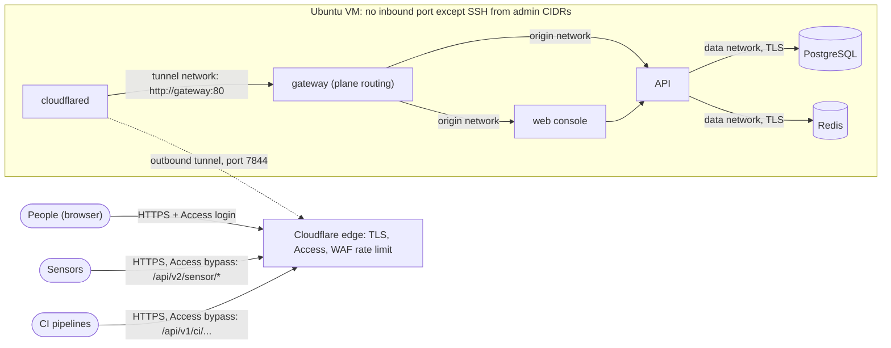

# OpenCTEM self-hosting with Ansible

Install and operate a self-hosted [OpenCTEM](https://github.com/openctemio/openctem)
platform on one Ubuntu VM: a hardened host, OpenCTEM (web console, API,
gateway, PostgreSQL, Redis) from signed release images pinned by digest,
Cloudflare Tunnel and Access in front, and encrypted daily backups with a
tested restore. Every stage is opt-in, rehearsable with `--check --diff`, and
keeps your site data outside this repository.

- Target: **Ubuntu 26.04 LTS** (24.04 works for every role except the pinned
  Docker packages), on any hypervisor or cloud VM.
- Controller: Linux or macOS with Python 3.11–3.13 and ansible-core 2.18.
- Sensors are not installed here: they run elsewhere and connect to the
  platform through the same public URL.



## Contents

1. [Prerequisites](#1-prerequisites)
2. [Quickstart (15 minutes)](#2-quickstart-15-minutes)
3. [Full runbook](#3-full-runbook)
4. [First administrator](#4-first-administrator)
5. [Backups and restore drill](#5-backups-and-restore-drill)
6. [Upgrade and rollback](#6-upgrade-and-rollback)
7. [Troubleshooting](#7-troubleshooting)
8. [Security model and hardening checklist](#8-security-model-and-hardening-checklist)
9. [Repository layout and tests](#9-repository-layout-and-tests)

Detailed references: [Cloudflare Tunnel and Access](docs/CLOUDFLARE-ACCESS.md) ·
[Firewall](docs/FIREWALL.md) · [docs site page](docs/self-hosting-with-ansible.md).

## 1. Prerequisites

| | Minimum | Notes |
|---|---|---|
| VM | 4 vCPU, 8 GB RAM (7 GB usable), 80 GB disk | The default limits fit this size with ~1.5 GB left to the OS (below). |
| OS | Ubuntu 26.04 LTS, fresh install, SSH reachable | A sudo user (`ubuntu`), your SSH public key in its `authorized_keys`. |
| Console | hypervisor console access to the VM | for recovery if SSH breaks; take snapshots |
| DNS | a zone on Cloudflare (any plan) | one host name, e.g. `ctem.example.com` |
| Cloudflare | Zero Trust (free tier is enough) with your identity provider | [docs/CLOUDFLARE-ACCESS.md](docs/CLOUDFLARE-ACCESS.md) |
| Backups | an [age](https://age-encryption.org) key pair, kept OFF the server | recommended; without it backups stay local and unencrypted |

Memory budget (4 vCPU / 7 GB): PostgreSQL 2 GB (shared_buffers 512 MB), API
1.5 GB, web 768 MB, Redis 512 MB, gateway 256 MB, cloudflared 256 MB (job
signer 128 MB): about 5.4 GB for containers. Change the `openctem_mem_*` and
`openctem_pg_*` values in your inventory for a bigger host.

**Without Cloudflare (optional):** set `openctem_ingress: loopback`. The
gateway then listens on `127.0.0.1:8080` (plain HTTP) for a TLS reverse proxy
you run on the host (Caddy, nginx). You own TLS, client-address forwarding
(the proxy must set `X-Forwarded-For`) and access control. Opening 443 in the
firewall is then your change.

## 2. Quickstart (15 minutes)

On the controller:

```bash
git clone https://github.com/openctemio/openctem-ansible.git && cd openctem-ansible
python3 -m venv .venv && . .venv/bin/activate
pip install 'ansible-core>=2.18,<2.19'
ansible-galaxy collection install -r requirements.yml -p ./collections

# Your site data lives OUTSIDE the repository.
mkdir -p ~/.config/openctem-ansible && cp -r inventories/example ~/.config/openctem-ansible/inventory
mv ~/.config/openctem-ansible/inventory/group_vars/all.yml.example ~/.config/openctem-ansible/inventory/group_vars/all.yml
$EDITOR ~/.config/openctem-ansible/inventory/hosts.ini          # your VM address and user
$EDITOR ~/.config/openctem-ansible/inventory/group_vars/all.yml # host name, admin CIDRs, age public key
INV=~/.config/openctem-ansible/inventory/hosts.ini
```

In Cloudflare: create the tunnel and copy its token
([§1](docs/CLOUDFLARE-ACCESS.md#1-create-the-tunnel)). On the VM (console or
SSH), store the token:

```bash
sudo install -d -m 0700 -o root -g root /opt/openctem/secrets
sudo sh -c 'umask 077; cat > /opt/openctem/secrets/cloudflared_tunnel_token'   # paste, Enter, Ctrl-D
sudo chown 65532:65532 /opt/openctem/secrets/cloudflared_tunnel_token && sudo chmod 0400 /opt/openctem/secrets/cloudflared_tunnel_token
```

Then, from the controller (`-K` asks for the sudo password):

```bash
ansible-playbook -i $INV playbooks/00-preflight.yml -K               # read-only
ansible-playbook -i $INV site.yml -K --check --diff \
  -e apply_os=true -e apply_ssh=true -e apply_docker=true -e apply_firewall=true
ansible-playbook -i $INV site.yml -K \
  -e apply_os=true -e apply_ssh=true -e apply_docker=true -e docker_daemon_restart=true \
  -e apply_firewall=true -e apply_openctem=true -e apply_backup=true -e apply_monitoring=true
```

Finish the Cloudflare side ([§2–§5](docs/CLOUDFLARE-ACCESS.md#2-access-application-for-people)),
create the first administrator ([§4](#4-first-administrator)), and run the
acceptance tests ([§3.10](#310-acceptance-tests)). For a production host,
follow the full runbook instead: it applies one stage at a time with a
snapshot and a dry run in between.

## 3. Full runbook

Every command below runs from the repository root on the controller with
`INV=~/.config/openctem-ansible/inventory/hosts.ini`. Each stage changes the
host only when its `apply_*` flag is true. Without it, the play prints that it
was skipped.

### 3.1 Preflight (read-only)

```bash
ansible -i $INV openctem -m ping
ansible-playbook -i $INV playbooks/00-preflight.yml -K
```

Checks the OS, sudo, CPU/RAM/disk, the tunnel token's owner and mode (metadata
only: the token is never read), Docker, listeners, ufw, time sync and the
effective sshd settings. Fix anything unexpected before going on.

### 3.2 Snapshot

Take a hypervisor snapshot of the VM, and keep its console open for the SSH
and firewall stages. A snapshot is a change checkpoint, not a backup: delete
it after the change is accepted.

### 3.3 Rehearse

```bash
ansible-playbook -i $INV site.yml -K --check --diff -e apply_os=true -e apply_ssh=true \
  -e apply_docker=true -e apply_firewall=true
```

`--check` cannot predict everything: package installs, the DevSec roles'
internal checks and Docker-dependent tasks are skipped or approximate on a host
without Docker yet. Read the diff; then apply stage by stage.

### 3.4 OS baseline

```bash
ansible-playbook -i $INV playbooks/10-os.yml -K -e apply_os=true
```

DevSec OS hardening (kernel/sysctl, file permissions, login defaults; IPv4
forwarding kept on for Docker), unattended **security** upgrades (no automatic
reboot unless `os_baseline_unattended_reboot: true`), chrony, auditd with
rules for identities, sudoers, SSH, Docker and `/opt/openctem/secrets`
(reads included), and a persistent journal capped at 1 GB / 1 month. Each part
can be turned off (`roles/os_baseline/defaults/main.yml`); tags `os_devsec`,
`os_updates`, `os_time`, `os_audit`, `os_journal`.

### 3.5 SSH

```bash
ansible-playbook -i $INV playbooks/20-ssh.yml -K -e apply_ssh=true                 # stage 1
ansible-playbook -i $INV playbooks/20-ssh.yml -K -e apply_ssh=true -e ssh_stage=2  # stage 2
```

Stage 1 applies DevSec SSH hardening (no root login, no forwarding, strong
algorithms) and keeps password login as a fallback. It also installs fail2ban
for sshd (admin CIDRs never banned). Open a **new** SSH session with your key
before stage 2. Stage 2 first proves a key-only login from this controller,
refuses otherwise, then turns passwords off and proves the key login again.

### 3.6 Docker

```bash
ansible-playbook -i $INV playbooks/30-docker.yml -K -e apply_docker=true -e docker_daemon_restart=true
```

Docker Engine and the compose plugin from Docker's apt repository. The key is
checked by hash and fingerprint, versions are pinned in `versions.yml` and
held (`apt-mark hold`). The role stops with a clear message if Docker
publishes no repository for the host's release. `daemon.json`: log rotation,
`live-restore`, `userland-proxy: false`, `no-new-privileges`. **Nobody is
added to the `docker` group** (it is root-equivalent); use `sudo docker ...`.

### 3.7 Firewall

```bash
ansible-playbook -i $INV playbooks/35-firewall.yml -K -e apply_firewall=true
```

ufw: deny inbound except SSH from `admin_cidrs`. Refuses to run if this
controller is outside them. Read [docs/FIREWALL.md](docs/FIREWALL.md) for why
Docker-published ports bypass ufw and how this deployment avoids publishing any.

### 3.8 OpenCTEM

Place the tunnel token first (see the quickstart), then:

```bash
ansible-playbook -i $INV playbooks/50-openctem.yml -K -e apply_openctem=true
```

What it does, in order:

1. checks that the tunnel token is present, owned by uid 65532 and mode 0400
   (metadata only), and that the release is pinned by digest;
2. copies the release's gateway configuration and database-roles SQL (vendored
   here, verified against `SHA256SUMS` on the controller);
3. **generates every secret on the host** (`/usr/local/sbin/openctem-secrets`,
   `openssl rand`): database superuser, migrator and app passwords, Redis
   password, `APP_ENCRYPTION_KEY`, `FINGERPRINT_KEY`, metrics token. Files are 0400 in
   `/opt/openctem/secrets` (0700, root). Values never leave the host or reach
   Ansible output; a second run changes nothing;
4. **verifies every OpenCTEM image digest** with cosign against the release
   workflow's keyless identity
   (`https://github.com/openctemio/openctem/.github/workflows/docker-publish.yml@refs/tags/<version>`),
   before pulling;
5. renders `/opt/openctem/compose.yml` (+ `compose.cloudflared.yml`), pulls,
   starts with `--wait`: database roles and migrations run as one-shot jobs
   before the API starts;
6. runs `/usr/local/sbin/openctem-verify`: every service healthy, no port
   published, the gateway routes the console, the API, the sensor and CI
   planes correctly, internal endpoints closed, other host names refused.

Containers run with `cap_drop: ALL` (Postgres and Redis keep only what their
entrypoints need to drop to their own users), `no-new-privileges`, read-only
root filesystems where the image allows, memory/CPU/PID limits, health checks,
`restart: unless-stopped` and rotated logs.

### 3.9 Cloudflare

Follow [docs/CLOUDFLARE-ACCESS.md](docs/CLOUDFLARE-ACCESS.md):
the public hostname route to `http://gateway:80` (in the dashboard, or with
`cloudflared_management: local` for a locally managed tunnel); one Access application for
people (IdP + MFA); Bypass applications on exactly `/api/v2/sensor/*`,
`/api/v3/sensor/*`, `/api/v1/ci/oidc/exchange` and `/api/v1/ci/runs/*`; a WAF
rate limit on them; WebSockets on.

Sensors and CI use the same URL as people: `https://<openctem_app_host>`.

### 3.10 Acceptance tests

On the host: `sudo openctem-verify`. From outside: the commands and the
expected results in [docs/CLOUDFLARE-ACCESS.md §6](docs/CLOUDFLARE-ACCESS.md#6-acceptance-tests-run-from-a-machine-outside-your-network)
and the matrix in [docs/FIREWALL.md](docs/FIREWALL.md#acceptance-matrix). Then
the exposure audit and the general audit:

```bash
ansible-playbook -i $INV playbooks/85-exposure-audit.yml -K
ansible-playbook -i $INV playbooks/80-audit.yml -K
```

### 3.11 Backups and monitoring

```bash
ansible-playbook -i $INV playbooks/55-backup.yml -K -e apply_backup=true -e backup_run_now=true
ansible-playbook -i $INV playbooks/60-monitoring.yml -K -e apply_monitoring=true
```

Then run a restore drill ([§5](#5-backups-and-restore-drill)).

## 4. First administrator

OpenCTEM has no default account. Create the first platform administrator and
its break-glass backup **on the server's console or an interactive SSH
session**. The one-time credentials are printed once, to that terminal only.
The wrapper refuses to run without a terminal, so it can never print into
Ansible output or a log file.

```bash
sudo openctem-bootstrap-admin -email=admin@example.com -backup-email=breakglass@example.com
# optionally the first organization and its owner:
sudo openctem-bootstrap-admin -email=admin@example.com -backup-email=breakglass@example.com \
  -org-name="Example Security" -org-owner-email=owner@example.com
```

Sign in at `https://<app host>/login` with the printed temporary password,
change it, and enroll an authenticator (TOTP), which the admin console
requires. Store the break-glass credentials offline. Organizations are created
by the platform administrator: public sign-up is off (`openctem_signup_mode:
disabled`, the API's `SIGNUP_MODE`), and no console change can open it. Configure
e-mail in the admin console (System → E-mail) so invitations can be sent.

### Sign-up modes

`openctem_signup_mode` sets the API's sign-up ceiling (`SIGNUP_MODE`):

| Value | Who can create an account | Who creates organizations |
|---|---|---|
| `disabled` (default) | the platform administrator, an invitation, or an organization's SSO | the platform administrator |
| `domain` | also anyone whose address is on an organization's verified domain; they join that organization | the platform administrator |
| `open` | anyone (hosted service) | anyone, within the console policy and the limits |

The admin console (System → Sign-up) can keep sign-up closed or pause it below
the ceiling, never above it. `domain` and `open` verify every self-registered
address, so the API refuses to start until the platform e-mail is set: run
`openctem-bootstrap-admin` with `BOOTSTRAP_SMTP_*` first, or deploy once with
`disabled`, set System → E-mail, then change the mode and deploy again.

**Hosted-service sign-up** (`open` on the internet) also needs Cloudflare
Turnstile, or the API refuses to start in production:

```yaml
openctem_signup_mode: open
openctem_captcha_turnstile_site_key: "0x4AAAA..."   # public site key
```

and the secret on the server (never in the inventory), which the secrets
script adds to `api.env`:

```sh
printf '%s' '0x4AAAA...secret' | sudo install -m 0400 /dev/stdin /opt/openctem/secrets/captcha_turnstile_secret
```

Upgrading from a kit that set `openctem_tenant_creation_mode`: remove it.
`admin_only` is `openctem_signup_mode: disabled` (the default); `self_service`
is `open`. The play stops while the old variable is set.

### Automatic coverage

OpenCTEM (v0.9.6 and later, with fixes in v0.9.7) keeps each organization's
assets covered on its own: a background loop takes the assets that are due
for a capability (subdomain
discovery, DNS, ports, HTTP probe, templates; never an intrusive one), passes
them through the scope gate and runs them on the organization's
"Continuous coverage" scans. That needs a sensor able to run those tools.

- **On by default for every organization.** It stays **off** for an
  organization whose scan approval mode is **Strict**, until that organization
  turns it on.
- **Per organization:** console → **Scoping → Settings → Automatic coverage**.
  Changing it needs the scope-approver permission and a recent
  re-authentication; it is audited and every administrator is notified.
- **Platform-wide** (operator): `ASSET_COVERAGE_ENABLED: "false"` turns the
  loop off, and `ASSET_COVERAGE_DAILY_BUDGET` caps attempts per organization per
  24 hours (default 5000). Set them in your inventory:

  ```yaml
  openctem_api_env:
    ASSET_COVERAGE_DAILY_BUDGET: "2000"
  ```

  then rerun `playbooks/50-openctem.yml`. `openctem_api_env` accepts
  non-secret settings only; the role refuses the ones it manages itself.

Review each organization's scope (Scoping) before onboarding its assets: with
automatic coverage on, in-scope assets are scanned without a manual trigger.

## 5. Backups and restore drill

`openctem-backup` runs daily (systemd timer, 03:15 UTC) and on demand
(`sudo systemctl start openctem-backup`). One backup is a directory under
`/var/backups/openctem/<UTC time>/` (0700, root) with:

- `openctem.dump`: `pg_dump -Fc`, checked with `pg_restore --list`;
- `api-data.tar.gz`: uploaded attachments and evidence;
- `signer-*.tar.gz`: the job signer's key and state, when the signer is on;
- `secrets.tar.gz`: the generated secrets. `APP_ENCRYPTION_KEY` decrypts the
  stored integration credentials, so a dump without it is unusable. The
  tunnel token is not included: re-issue it in Cloudflare;
- `deployment.tar.gz`, `VERSION`, `SHA256SUMS`.

Retention: `backup_keep_days` (14).

**Two modes:**

| `backup_age_recipient` | Mode |
|---|---|
| empty | **local**: plaintext files, root-only, on this host only. An off-host copy is refused, and every run logs that the backups are not off-host. |
| `age1...` (public key) | **age**: every file is encrypted on the host to your public key (`*.age` + `MANIFEST.sha256`); the plaintext staging copy is deleted. Off-host copy allowed. |

Create the key on your workstation, never on the server:

```bash
age-keygen -o ~/openctem-backup-identity.txt     # keep it offline (password manager, hardware token)
age-keygen -y ~/openctem-backup-identity.txt     # prints age1...: put it in backup_age_recipient
```

**Off-host copy:** set `backup_offsite_command` to a command that receives the
new backup directory as `$1`, e.g. `rclone copy --config
/root/.config/rclone/rclone.conf "$1" offsite:openctem/$(basename "$1")`. Keep
the remote's credentials in a root-only file on the host. Only encrypted
backups are copied.

**Restore drill** (monthly at least): restores into a throwaway PostgreSQL
with no network and compares row counts with the running database, without
touching the stack.

```bash
# local mode
sudo openctem-restore-drill
# age mode: copy the identity to the host for the drill only, then delete it
scp ~/openctem-backup-identity.txt vm:/tmp/id.txt
ssh -t vm 'sudo install -m 0600 /tmp/id.txt /root/drill.key && rm /tmp/id.txt && \
  sudo openctem-restore-drill /var/backups/openctem/<UTC time> /root/drill.key; sudo rm -f /root/drill.key'
```

**Full restore** over the running stack (stops cloudflared, gateway, web and
API while it runs, replaces the database and the uploaded files, re-applies
the database roles, starts what was running, verifies):

```bash
sudo openctem-restore /var/backups/openctem/<UTC time> [/root/drill.key] --yes
```

On a **new host**, deploy the backup's release first (`VERSION`), then add
`--with-secrets`: it restores the generated secrets (so `APP_ENCRYPTION_KEY`
matches the data) except the new host's own Postgres superuser password. Rerun
`playbooks/50-openctem.yml` afterwards to reset file owners.

## 6. Upgrade and rollback

Releases this kit can run are listed in `versions.yml` (`openctem_releases`,
digests per image). To upgrade:

```bash
git pull                                            # a kit version that lists the release
ansible-playbook -i $INV playbooks/50-openctem.yml -K -e apply_openctem=true -e openctem_version=vX.Y.Z
```

Then set `openctem_version` in your inventory. The play:

1. verifies the new images' signatures;
2. runs a **backup first** and stops if it fails (the backup role must be
   installed; `-e openctem_backup_before_upgrade=false` only after a backup you
   took yourself);
3. keeps the running compose file as `compose.prev.yml` and the previous
   release's gateway files under `/opt/openctem/releases/<version>`;
4. pulls and starts the new release; migrations run before the API starts;
5. verifies. **On any failure it restores `compose.prev.yml`**, starts the
   previous release and verifies again.

Manual rollback, for example a problem found after the upgrade:

```bash
ansible-playbook -i $INV playbooks/71-rollback.yml -K -e apply_rollback=true
```

Going back starts the previous release **without its migration job**: an
older migration job refuses a database a newer release already migrated, and
an older API runs on the newer schema (tested: v0.9.6 on the v0.9.7 schema).
Migrations are not reversed. If the previous release misbehaves on the
migrated database, restore the pre-upgrade backup with `openctem-restore`
while the previous release runs.

### 6.1 Upgrading to v0.10.0

Read before the first apply of the kit version that lists v0.10.0.

1. **`FINGERPRINT_KEY` is required** (at least 32 characters). It keys the
   fingerprint of every stored secret finding. The kit manages it on the host
   like the encryption key (`/opt/openctem/secrets/fingerprint_key`, 0400,
   root, never printed, never in Ansible output):
   - on an **existing install** the first apply copies the stored
     `app_encryption_key` into `fingerprint_key`, because that is the key the
     existing fingerprints were made with. It never generates a new random one
     for an install that already has an encryption key: a different value gives
     every known secret a new identity and reopens each as a new finding;
   - a **new install** gets its own random key, independent of the encryption
     key;
   - the play refuses to deploy while the file is missing, shorter than 32
     characters or not 0400. Never set `FINGERPRINT_KEY` through
     `openctem_api_env` (refused);
   - back it up with the database: `openctem-backup` includes it, and
     `openctem-restore --with-secrets` restores it (a backup taken before this
     kit version has none: this server's stays).
   - Verify after the apply: `sudo stat -c '%a %U %s' /opt/openctem/secrets/fingerprint_key`
     prints `400 root 65` (or more), and
     `sudo cmp /opt/openctem/secrets/fingerprint_key /opt/openctem/secrets/app_encryption_key`
     is silent on an upgraded install (identical). Do not print either file.
2. **`TENANT_CREATION_MODE` is gone** (the API refuses to start while it is
   set). The kit never renders it; `openctem_signup_mode` (default `disabled`)
   becomes `SIGNUP_MODE`. `openctem_api_env` refuses `TENANT_CREATION_MODE` and
   the other names v0.10.0 removed (`openctem_api_env_removed`). If your
   inventory still sets `openctem_tenant_creation_mode`, remove it (the play
   already stops on it).
3. **Other v0.10.0 settings, checked against the release's environment
   registry** (`api/internal/config/env_registry.yaml`):
   - the other variables required in production (`DB_PASSWORD`,
     `REDIS_PASSWORD`, `REDIS_TLS_ENABLED`, `APP_ENCRYPTION_KEY`,
     `DB_SSLMODE`, `AUTH_COOKIE_SECURE`) are already set by the kit;
   - `ADMIN_AUDIT_SINK_SECRET` is needed only with an `https://`
     `ADMIN_AUDIT_SINK`, which the kit does not configure; the kit has no
     `ADMIN_AUDIT_SINK_TOKEN`. Do not add either through `openctem_api_env`:
     secret-looking names are refused, so configure a sink only outside the
     kit and plan a secret file for it first;
   - `ADMIN_LISTEN_ADDR` and `ADMIN_ALLOWED_CIDRS` are not read by v0.10.0 and
     the release ships no console gateway site; the kit renders them only for a
     release flagged `admin_plane: true` in `versions.yml`, and
     `scripts/vendor-release.sh` flags none for v0.10.0. Leave `openctem_admin_host` empty (the play stops otherwise);
   - there is no `INTERNAL_API_*` variable in v0.10.0;
   - the SMTP variables are removed (platform e-mail is set in the console,
     System > E-mail); the kit never rendered them.
4. **Database role for the console.** The v0.10.0 least-privilege SQL has the
   console identity role (`admin_user`; v0.9.7's has none), so
   `scripts/vendor-release.sh` flags the release `console_db_role: true` and the
   kit renders `DB_ADMIN_USER`/`DB_ADMIN_PASSWORD` for it. The password
   (`db_console_password`) is already generated on every install. This path has
   not run on a live release before: check that `openctem-verify` passes and
   the API starts after the upgrade.
5. Take the usual pre-upgrade backup (the play does), then:

```bash
git pull
ansible-playbook -i $INV playbooks/50-openctem.yml -K -e apply_openctem=true -e openctem_version=v0.10.0
```

Rollback to v0.9.7 keeps working (an older API ignores `FINGERPRINT_KEY`);
see the rollback notes below.

## 7. Troubleshooting

| Symptom | Cause and fix |
|---|---|
| `install: invalid user '65532'` (Ubuntu 26.04) | Ubuntu 26.04 ships the Rust **uutils** coreutils, whose `install -o` needs a passwd entry. Use `chown 65532:65532` (numeric ids work) or Ansible's `file`/`copy` with numeric owners, as this kit does. |
| A GNU flag of `stat`/`date`/`sed -i` behaves differently | uutils replaces coreutils (not sed, grep, find or tar, which stay GNU). This kit's scripts use only flags tested on 26.04 (`tests/smoke.sh` runs them there). |
| `sudo` behaves differently / Ansible become fails | 26.04 defaults to `sudo-rs`. Classic sudo is `/usr/bin/sudo.ws`: set `ansible_become_exe=/usr/bin/sudo.ws` in the inventory. |
| Python warnings about the interpreter | set `ansible_python_interpreter=/usr/bin/python3.14` (26.04) in the inventory. |
| A port is reachable although ufw denies it | a container publishes it: Docker bypasses ufw ([docs/FIREWALL.md](docs/FIREWALL.md)). `playbooks/85-exposure-audit.yml` lists them. |
| Containers have no internet after hardening | `net.ipv4.ip_forward` was turned off, or `iptables: false` was set in `daemon.json`. The OS role pins forwarding on; remove `iptables: false`. |
| Tunnel "Down" / `cloudflared` unhealthy | outbound 7844/udp and 7844/tcp blocked upstream, or a wrong token: `sudo docker logs openctem-cloudflared-1` (tokens are not printed), re-place the token, `sudo docker compose -p openctem -f /opt/openctem/compose.yml -f /opt/openctem/compose.cloudflared.yml up -d cloudflared`. |
| 503 for every path through the tunnel, connector logs `No ingress rules were defined` | the tunnel has no route. Remotely managed tunnel: add the public hostname in the dashboard. Locally managed tunnel (the dashboard says routes come from the local configuration file): set `cloudflared_management: local` and re-run `playbooks/50-openctem.yml` ([docs/CLOUDFLARE-ACCESS.md §1](docs/CLOUDFLARE-ACCESS.md#1-create-the-tunnel)). |
| `--check` stops at a read-only check | every read-only command task runs under `--check` (`check_mode: false`); tasks that depend on packages a previous stage installs (auditd, fail2ban) report "not found" in check mode before that stage ran. Run the stages in order. |
| Firewall stage refuses: "Controller address … is not inside admin_cidrs" | the lockout guard: the address you connect from is not in `admin_cidrs`. Add your network (several CIDRs are fine) before enforcing. |
| 404 for every page through the tunnel | the route sends another host name, or an HTTP Host Header override: the gateway serves only `openctem_app_host`. |
| Sensors or CI get an HTML login page | the Access Bypass application for that path is missing or its path is wrong ([docs/CLOUDFLARE-ACCESS.md §3](docs/CLOUDFLARE-ACCESS.md#3-access-bypass-applications-for-machines)). |
| Sensors get 429 | the WAF rate limit is too low for the number of sensors behind one address. |
| Uploads over 100 MB fail | Cloudflare's request body limit (Free/Pro). |
| `docker compose` "no configuration file" | always name the project and files: `sudo docker compose -p openctem -f /opt/openctem/compose.yml -f /opt/openctem/compose.cloudflared.yml ps` (or `cd /opt/openctem` first, where `.env` sets them). |
| Deploy stops at "Verify the release signatures" | the image digest is not signed by the release workflow at that tag, or sigstore is unreachable. Do not disable `openctem_verify_signatures` to get past it; investigate. |
| Backup "off-host copy refused" | backups are in local (unencrypted) mode: set `backup_age_recipient`. |
| API log shows `GET /api/v2/sensor/hello` 401, `POST /api/v1/ci/oidc/exchange` 400 and `GET /api/v1/me` every 5 minutes with no sensor installed | expected: the monitor (`openctem-monitor`, through the tunnel) and `openctem-verify` (inside the gateway) probe that sensors and CI reach the API and that people are challenged by Access. Their user agents are `openctem-monitor` and `openctem-verify`. A 404 on `/api/v1/me` with an alert "without a Cloudflare Access challenge" means the Access application is not enforcing yet. |
| `journalctl -t openctem-monitor` shows alerts | each line names the failing check: health, routing, disk, backup age, tunnel path, certificate, Access. |

Logs: `sudo docker compose -p openctem -f ... logs <service>`, `journalctl -u
openctem-backup`, `journalctl -t openctem-monitor`, `sudo ausearch -k
openctem_secrets` (who read the secrets).

## 8. Security model and hardening checklist

**Trust boundaries.** The internet reaches the VM only through Cloudflare:
TLS, Access (people) or a Bypass on the exact machine paths, then the WAF rate
limit. Inside, cloudflared reaches only the gateway. The gateway routes by API
plane and refuses other host names and the internal endpoints (`/metrics`,
`/ready`, `/debug`). Only the API reaches PostgreSQL and Redis, over TLS, with
least-privilege database roles (the API's role has DML only; migrations run as
a separate schema owner). Machine paths are authenticated by OpenCTEM itself:
sensor keys and optionally signed jobs, and CI OIDC exchanged for a short-lived
run token.

**Secrets.** Generated on the host; files 0400 in a 0700 root directory,
passed to containers as environment files or mounted files, never as command
arguments. The tunnel token is placed by you and only its metadata is checked.
Ansible tasks that touch secrets use `no_log`. auditd records every read of
the secrets directory. Backups contain the secrets: encrypt them (age).

**Supply chain.** OpenCTEM images by digest with keyless cosign verification
against the release workflow and tag; third-party images (PostgreSQL, Redis,
cloudflared, cosign) by digest; Docker packages by version with a
fingerprint-checked key; collections by exact version; vendored release files
by SHA-256.

**Checklist** (after deployment):

- [ ] Snapshot taken before each stage and deleted after acceptance
- [ ] `00-preflight` clean; OS is Ubuntu 26.04 with security updates
- [ ] SSH stage 2 applied: `sshd -T` shows `passwordauthentication no`, `permitrootlogin no`
- [ ] ufw active: only 22/tcp from admin CIDRs; `85-exposure-audit` passes
- [ ] Nobody in the `docker` group
- [ ] `sudo openctem-verify` passes; no published port
- [ ] Cloudflare: Access app with IdP + MFA; Bypass apps only on the four machine paths; WAF rate limit; WebSockets on; no origin JWT check on the route
- [ ] Outside acceptance tests pass (console and `/api/v1/me` challenged; sensor 401; CI exchange 400)
- [ ] First administrator created on the console, TOTP enrolled, break-glass stored offline
- [ ] E-mail configured; sign-up policy `admin_only`
- [ ] Automatic coverage reviewed per organization (Scoping → Settings) and the daily budget set
- [ ] Backups in age mode, off-host copy configured, restore drill passed
- [ ] Monitoring timer active, webhook tested (`sudo systemctl start openctem-monitor`)
- [ ] Hypervisor-level backups or snapshots of the VM per your policy
- [ ] Calendar: monthly restore drill, OpenCTEM upgrades, rotation of the tunnel token and the age key yearly

Not covered here: OS-level CIS certification (DevSec hardening is not CIS
compliance), host intrusion detection, central log shipping, and a
compromised hypervisor or root on the host. A Docker internal network is no
boundary against root on the host.

## 9. Repository layout and tests

```
site.yml                 every stage in runbook order (each gated by apply_*)
playbooks/               00-preflight 10-os 20-ssh 30-docker 35-firewall 50-openctem
                         55-backup 60-monitoring 71-rollback 80-audit 85-exposure-audit
roles/                   os_baseline ssh docker firewall openctem cloudflared backup monitoring
                         (+ openctem_common: shared defaults, loads versions.yml)
versions.yml             every pinned version and digest
requirements.yml         exact collection versions
inventories/example/     example inventory; copy it outside the repository
docs/                    Cloudflare, firewall, docs-site page
scripts/vendor-release.sh   add an OpenCTEM release
tests/                   render.yml, smoke.sh (stack in Docker-in-Docker), role-e2e.sh (roles in DinD)
```

Tests never touch your workstation's containers: `tests/smoke.sh` and
`tests/role-e2e.sh` create one uniquely named Docker-in-Docker container and
run everything inside it. CI (`.github/workflows/ci.yml`) runs yamllint,
ansible-lint (production profile), syntax checks, shellcheck, template render
with `docker compose config`, a gitleaks scan, the smoke test and the roles
end to end on Ubuntu 26.04.

License: [Apache-2.0](LICENSE). Security reports: [SECURITY.md](SECURITY.md).
Contributions: [CONTRIBUTING.md](CONTRIBUTING.md).
