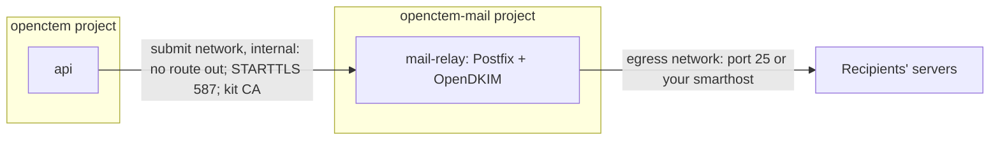

# Mail relay (optional)

A send-only Postfix container for the platform e-mail, for installations that
run no mail server and want no online mail provider. Off by default. The
user-facing guide, with the DNS records and the troubleshooting tables, is
[Send mail without an online provider](https://docs.openctem.io/configuration/mail-without-online-smtp/).



## Turn it on

Inventory:

```yaml
openctem_mail_relay: true                    # wires the platform to the relay
openctem_mail_relay_from: noreply@example.com # the platform sender, on a sender domain
mail_relay_hostname: mail.example.com        # public name: greeting and the PTR name
mail_relay_sender_domains: [example.com]     # the only domains it will send for
mail_relay_dkim: true                        # recommended
# mail_relay_smarthost: smtp.corp.example:587    # all mail goes there (TLS required)
# mail_relay_smarthost_login: true               # RELAYHOST_USERNAME/PASSWORD in <secrets>/mail_relay_smarthost.env (0400 root)
```

Apply the relay stage first (the platform joins its network), then the OpenCTEM stage:

```bash
ansible-playbook -i $INV playbooks/52-mail-relay.yml -K -e apply_mail_relay=true
ansible-playbook -i $INV playbooks/50-openctem.yml -K -e apply_openctem=true
```

The stage prints the CA fingerprint and writes `/opt/openctem-mail-relay/dns-records.txt`
(SPF, DKIM public key, DMARC, and what the PTR record must say). Publish them.

On a new installation `openctem-bootstrap-admin` stores the platform e-mail
setting for the relay (server `mail-relay`, port 587, STARTTLS, no login) with
the relay's CA certificate. Where e-mail is already configured, enter the same
in Console > Settings > E-mail and paste `<secrets>/mail_relay_ca/ca.crt`.

## What it is and is not

| Property | How |
|---|---|
| Not an open relay | Listens only on the `submit` network (`internal: true`: no route out, nothing published on the host). `mynetworks` is that /24 only; `smtpd_client_restrictions = permit_mynetworks,reject`; `smtpd_relay_restrictions` ends in `reject_unauth_destination`. |
| Only the platform's domains | `ALLOWED_SENDER_DOMAINS` is `mail_relay_sender_domains`; `openctem_mail_relay_from` must be on one. |
| TLS required for submission | `smtpd_tls_security_level = encrypt`, TLS 1.2 or later, certificate from the kit's own CA. The CA key stays in `<secrets>/mail_relay_ca` (root 0400, in the 0700 secrets directory, so in the secrets backup). |
| Platform trusts only that CA for this server | The CA certificate is stored as the platform's write-only e-mail CA bundle; no skip-verify switch exists. |
| API reach | `OPENCTEM_HTTPSEC_ALLOW_PRIVATE_CIDRS` gets exactly `<submit>.10/32`, merged with any value you set. |
| Least privilege | Own compose project, `cap_drop: ALL` plus the few Postfix needs, `no-new-privileges`, memory and pid limits, own queue volume, rotating logs. |
| Outbound | Its own `egress` network, under the egress policy when `openctem_egress_policy: restricted` (add a private smarthost to `openctem_egress_allow`). |
| DKIM | Key per domain, created once on the server (`<secrets>/mail_relay_dkim/<domain>.private`, 0444 inside the 0700 directory because the signer is not root; the file is mounted read-only). Never in the inventory or git. |
| Health | Compose healthcheck on port 587; the stage waits for healthy (`up --wait`). Logs: `docker compose -p openctem-mail -f /opt/openctem-mail-relay/compose.yml logs mail-relay`. |

## Tests

`tests/mail-relay.sh` renders everything (off by default, relay on, direct delivery,
smarthost with login, DKIM) and asserts the properties above on the parsed compose
files, plus the settings validation; CI also runs `docker compose config` on both
files. The role itself needs a host with Docker; `tests/role-e2e.sh` (Docker-in-Docker)
does not start the relay.

## Troubleshooting

| Symptom | Cause |
|---|---|
| Test e-mail: certificate not trusted | The CA certificate was not pasted/seeded, or the relay's certificate was reissued under a different CA (a rerun reuses the CA; only deleting `mail_relay_ca` makes a new one). |
| Test e-mail: address blocked | API env lacks the /32: render with `openctem_mail_relay: true` and redeploy the OpenCTEM stage. |
| The OpenCTEM stage fails: network not found | Run the relay stage first. |
| Mail accepted, never arrives | Port 25 closed outbound, missing PTR/SPF, or a smarthost that refuses this address: see the relay log and the DNS file. |
