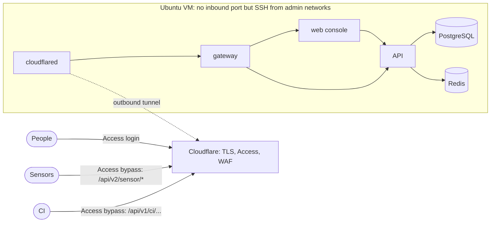

# Self-host OpenCTEM on a VM with Ansible

The `openctem-ansible` repository is the supported way to run OpenCTEM on a
single virtual machine. It hardens the host, deploys the platform from signed
release images pinned by digest, puts Cloudflare Tunnel and Access in front
of it, and installs daily encrypted backups, a restore drill and monitoring.
Every stage is opt-in and can be rehearsed with `--check --diff`.



## What you need

- A VM with 4 vCPU, 8 GB RAM and 80 GB disk, running **Ubuntu 26.04 LTS**,
  with SSH key access for a sudo user and access to its console.
- A DNS zone on Cloudflare and a Cloudflare Zero Trust account connected to
  your identity provider. Without Cloudflare you can put your own TLS reverse
  proxy on the host instead (`openctem_ingress: loopback`).
- An Ansible controller (Linux or macOS) with Python 3.11–3.13.
- An [age](https://age-encryption.org) key pair for backups, kept off the VM.

## Install in short

1. Clone the repository, install `ansible-core` 2.18 and the pinned
   collections, and copy `inventories/example` **outside** the repository.
   Set the VM address, the public host name, the administrator networks and
   your age public key there.
2. In Cloudflare, create a tunnel and store its token on the VM in
   `/opt/openctem/secrets/cloudflared_tunnel_token` (owner 65532, mode 0400).
3. Run the read-only preflight, take a VM snapshot, rehearse with
   `--check --diff`, then apply the stages one by one: OS baseline, SSH (keys
   only after a proven key login), Docker, firewall, OpenCTEM, backups and
   monitoring.
4. In Cloudflare, route the host name to `http://gateway:80`. Protect it with
   an Access application for people (identity provider and MFA). Add Access
   **Bypass** applications for exactly the machine paths sensors and CI call:
   `/api/v2/sensor/*`, `/api/v3/sensor/*`, `/api/v1/ci/oidc/exchange` and
   `/api/v1/ci/runs/*`. Rate-limit those paths with a WAF rule. The paths
   still require sensor keys or CI tokens in OpenCTEM.
5. Create the first administrator on the VM's console with
   `sudo openctem-bootstrap-admin`. The one-time credentials are shown only
   there.
6. Run the acceptance tests: the console and `/api/v1/me` are challenged by
   Access, the sensor path answers 401 without a key, and the VM publishes no
   port.

Step-by-step guides: [Install with Ansible](https://docs.openctem.io/install/ansible/),
[with Cloudflare Tunnel and Access](https://docs.openctem.io/install/ansible-cloudflare/) and
[without Cloudflare](https://docs.openctem.io/install/ansible-without-cloudflare/).

The repository README is the full runbook. It covers each command, what each
stage changes, backups and restore, upgrades with automatic rollback,
troubleshooting (including Ubuntu 26.04's uutils coreutils and Docker with
ufw) and a hardening checklist.

## Platform console as its own service

From a release flagged `console_service: true` in `versions.yml` (the release
that ships the `openctem-console` image: v0.10.1; older releases keep their
behaviour), the platform console is its own
service: another image, another process and another origin than the web
console, at the **root** of its site (there is no `/admin` path). A flaw in a
tenant-facing page cannot reach the administration plane, and the main host
name answers 404 for the console. The gateway serves the console only to
`openctem_admin_allowed_cidrs` (private networks by default); the API keeps
the console API on an internal listener nothing publishes.

| Variable | Default | Meaning |
|---|---|---|
| `openctem_admin_site` | `port` | `host`, `port` or `off` |
| `openctem_admin_host` | `''` | the console's host name, host mode only (e.g. `admin.example.com`) |
| `openctem_admin_port` | `8443` | port mode; not 80, 443 or `openctem_loopback_port` |
| `openctem_admin_bind` | `''` | port mode: the address the port is published on; `''` = the gateway's own bind (`127.0.0.1`) |
| `openctem_admin_allowed_cidrs` | private networks | client networks that may reach the console |

**Host mode is the recommended production setup**: the console on its own
host name, through the tunnel, behind its own Cloudflare Access application
(administrators only, hardware-key MFA where your identity provider offers it,
no Bypass rule):

```yaml
openctem_admin_site: host
openctem_admin_host: admin.example.com
openctem_admin_allowed_cidrs: [203.0.113.0/24]   # your staff's egress ranges
```

`roles/cloudflared` adds the host name to the tunnel (CLOUDFLARE-ACCESS.md,
section 2). **Never publish the console through a public tunnel without that
zero-trust layer.** Behind Cloudflare the client address is the visitor's, so
the default allow-list blocks every visitor: list your staff's ranges, or
`0.0.0.0/0` and `::/0` when the Access application is the gate.

**Port mode is the default, for simplicity**: the console on a second port
(`8443`, configurable) of the host. A port number is not a security control;
the allow-list and your network are. The gateway publishes it, so port mode
needs `openctem_ingress: loopback` (a container on the tunnel's internal
network publishes nothing: with the tunnel use host mode or `off`), and it is
never routed through the tunnel. The port binds to `127.0.0.1` unless you set
`openctem_admin_bind` to a private or VPN address; a published port bypasses
the host firewall, so never a public address, and
`playbooks/85-exposure-audit.yml` flags any non-loopback bind (list the
gateway in `exposure_allowed_containers` after review). The gateway speaks plain
HTTP here and the console's cookies are `Secure`, so reach it through a TLS
proxy, or through an SSH tunnel to `127.0.0.1:8443` (browsers accept Secure
cookies on localhost).

The identity provider of the console redirects to
`<console origin>/login/callback` (for example
`https://admin.example.com/login/callback`).

`openctem-verify` checks that the console's site answers. `openctem_admin_site:
off` runs the service without a site.

**Upgrade notes.** `openctem_admin_host` set with the default site would
silently move the console to a port, so the play stops: set
`openctem_admin_site: host`. The default `port` with the tunnel ingress also
stops the play with the reason. The console's old `/admin` URL and the web
console's `ADMIN_API_URL` are gone with the release. Sensors keep dialing the
main host on 443; the kit does not render the sensor ALPN/passthrough settings
(`SENSOR_MTLS_*`): they need a gateway that terminates TLS, and the kit's
gateway speaks plain HTTP behind the tunnel or your proxy.

With an older release the console settings above are ignored; only
`openctem_admin_host` (a release with `admin_plane`) is honoured as before.

## The console's own database role

From the release whose entry in `versions.yml` has `console_db_role: true`,
the stack adds a third database role, `openctem_console`. Only that role writes
the platform console's identity tables (administrators, console sessions and
credentials, the platform identity provider). The API's `openctem_app` then
only reads `admin_users`, so a SQL injection in the tenant-facing API cannot
add an administrator. Nothing to configure:

- `openctem-secrets` generates `db_console_password`, which backups include;
- `db-roles` creates the role and moves the tables, and a `db-grants` job
  runs the same script after the migrations, before the API;
- the API opens a second small pool as `openctem_console`, and
  `openctem-bootstrap-admin` connects as it.

A rollback to a release without the flag needs nothing either: that release's
`db-roles` runs the script without `admin_user`, which gives `openctem_app`
its write on those tables back before the older API starts.

## Administrators' audit sink

A hosted service (`MANAGED_SERVICE: "true"` in `openctem_api_env`) must copy the
platform administrators' audit chain out of the database. Set
`openctem_admin_audit_sink` in the inventory:

- `file`: the kit creates a host directory (default `/opt/openctem/admin-audit`,
  owned by the API's uid, mode 0750), mounts it into the API and includes it in
  every backup. It guards against database-level rewrites and leaves the host
  with the backups.
- `https://host/path`: the real off-box copy, recommended for a hosted service.
  Create the HMAC key on the server (at least 32 bytes, mode 0600) and give the
  same key to the receiver:

  ```bash
  sudo sh -c 'umask 077; openssl rand -hex 32 > /opt/openctem/secrets/admin_audit_sink_secret'
  ```

`openctem_admin_audit_sink_head_interval` (for example `5m`) sets how often the
signed chain head is written. `syslog+tls://` is not supported by the kit yet.
A release that requires the sink fails the play before any change when
`MANAGED_SERVICE` is true and no sink is set. Details: the README, "Administrators'
audit sink".

## Security model

- The VM accepts no inbound connection except SSH from your administrator
  networks. The tunnel is outbound-only, and no container publishes a port.
- People pass Cloudflare Access. Sensors and CI bypass it only on their own
  paths, where OpenCTEM authenticates them itself.
- Secrets are generated on the VM and never leave it, except inside encrypted
  backups.
- OpenCTEM images are verified with cosign against the release workflow
  before they run; every other image, package and collection is pinned.
- Upgrades back up first and roll back automatically if the new release fails
  its checks.
