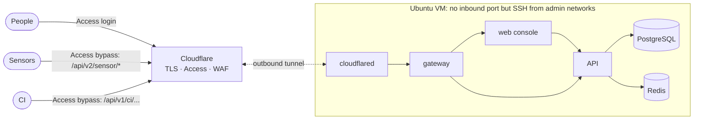

# Self-host OpenCTEM on a VM with Ansible

The `openctem-ansible` repository is the supported way to run OpenCTEM on a
single virtual machine. It hardens the host, deploys the platform from signed
release images pinned by digest, puts Cloudflare Tunnel and Access in front
of it, and installs daily encrypted backups, a restore drill and monitoring.
Every stage is opt-in and can be rehearsed with `--check --diff`.

## What you need

- A VM with 4 vCPU, 8 GB RAM and 80 GB disk, running **Ubuntu 26.04 LTS**,
  with SSH key access for a sudo user and access to its console.
- A DNS zone on Cloudflare and a Cloudflare Zero Trust account connected to
  your identity provider. Without Cloudflare you can put your own TLS reverse
  proxy on the host instead (`openctem_ingress: loopback`).
- An Ansible controller (Linux or macOS) with Python 3.11–3.13.
- An [age](https://age-encryption.org) key pair for backups, kept off the VM.

## Install in short

1. Clone the repository, install `ansible-core` 2.18 and the pinned
   collections, and copy `inventories/example` **outside** the repository.
   Set the VM address, the public host name, the administrator networks and
   your age public key there.
2. In Cloudflare, create a tunnel and store its token on the VM in
   `/opt/openctem/secrets/cloudflared_tunnel_token` (owner 65532, mode 0400).
3. Run the read-only preflight, take a VM snapshot, rehearse with
   `--check --diff`, then apply the stages one by one: OS baseline, SSH (keys
   only after a proven key login), Docker, firewall, OpenCTEM, backups and
   monitoring.
4. In Cloudflare, route the host name to `http://gateway:80`. Protect it with
   an Access application for people (identity provider and MFA). Add Access
   **Bypass** applications for exactly the machine paths sensors and CI call:
   `/api/v2/sensor/*`, `/api/v3/sensor/*`, `/api/v1/ci/oidc/exchange` and
   `/api/v1/ci/runs/*`. Rate-limit those paths with a WAF rule. The paths
   still require sensor keys or CI tokens in OpenCTEM.
5. Create the first administrator on the VM's console with
   `sudo openctem-bootstrap-admin`. The one-time credentials are shown only
   there.
6. Run the acceptance tests: the console and `/api/v1/me` are challenged by
   Access, the sensor path answers 401 without a key, and the VM publishes no
   port.

The repository README is the full runbook. It covers each command, what each
stage changes, backups and restore, upgrades with automatic rollback,
troubleshooting (including Ubuntu 26.04's uutils coreutils and Docker with
ufw) and a hardening checklist.

## Security model

- The VM accepts no inbound connection except SSH from your administrator
  networks. The tunnel is outbound-only, and no container publishes a port.
- People pass Cloudflare Access. Sensors and CI bypass it only on their own
  paths, where OpenCTEM authenticates them itself.
- Secrets are generated on the VM and never leave it, except inside encrypted
  backups.
- OpenCTEM images are verified with cosign against the release workflow
  before they run; every other image, package and collection is pinned.
- Upgrades back up first and roll back automatically if the new release fails
  its checks.
